# LOOM v10

**Music workshop / composition room / listening laboratory**

LOOM is a deliberately human music-making environment. You write the notes, shape the rhythm, change the instrument, move layers around, listen, inspect the structure, and keep the project as editable data. There is no hosted generative music API in the runtime.

> **📖 New here? Read the [User & Production Guide (PDF, 34 pages)](docs/LOOM-Guide.pdf)** — what every control does, how to make country / poetry / retro / jazz / soothing-acoustic music step by step, and how the audio engine, generators, sharing and collaboration work underneath. (Source: [docs/guide/LOOM-Guide.html](docs/guide/LOOM-Guide.html); rebuild with `python tools/build_guide.py`.)

## The experience

- **Front door:** editorial, warm, antique-studio visual language rather than a SaaS hero-template.
- **Studio:** a browser DAW built around the **5-element formula** — 1 Drums, 2 Bass, 3 Mids, 4 Vox, 5 Effects — with four views:
  - **Pattern** (canvas piano roll): draw / select / erase, drag-move and resize, box select, velocity lane, snap incl. triplets, zoom, key & scale highlighting, *fit to key*, quantize, humanize, copy / paste / duplicate, undo / redo, ghost notes from other layers, and a **chord palette** (the 7 chords of the current key plus any root and 16 qualities, inversions, octaves; chords chain at an insert cursor) with an **arpeggiator**.
  - **Steps**: a drum step sequencer — click or drag-paint hits, Shift-click for accent / normal / ghost, 16 drum lanes.
  - **Arrange**: a song timeline with named **sections** (click one to select it, then duplicate it or cut it out for every track), per-track lanes with note thumbnails, and **audio clips** with waveforms — drag to move (even between tracks), trim either edge, split, duplicate, fade in / out, overlap freely to crossfade, speed-match to the project tempo. Drop audio files straight onto a lane.
  - **Mixer**: a strip per track (volume, pan, low-pass, 3-band EQ, delay and reverb sends, mute / solo, live level meters) plus master.
- **Sound:** 77 instruments. **31 of them play real recordings** (grand piano, Rhodes, steel / nylon / clean / overdriven / distorted / muted guitars, banjo, harp, three basses, marimba, vibraphone, violin, cello, strings, brass, sax, flute, organ, choir …) and the **Acoustic kit uses recorded acoustic drums**, plus LinnDrum LM-2 and Roland CR-78 kits; everything else, and any lane or note a recording does not cover, is synthesised. A *recorded samples* switch under *master* flips a project back to the pure-synth sound (it also loads nothing until needed). The audio is third-party and openly licensed: see `frontend/assets/samples/CREDITS.md` (CC BY 3.0 attribution to Frank Wen's FluidR3_GM and to enoe's Pearl Master Studio drums). — *Drums* (8 kits: Acoustic, Rock, Jazz Brush, 808, Trap, Lo-Fi, Electronic, House; 16 drum lanes incl. toms, clap, rim, cowbell, congas, tambourine, clave), *Bass* (Sub, Synth, Electric, Pluck, Acid 303, Reese, FM, Wobble, Slap, Upright, Square Sub), *Mids* (keys: Soft Keys, Rhodes, Grand Piano, Organ, Clav, Vibraphone, Marimba, Kalimba, Music Box, Accordion · **guitars**: Acoustic, Electric Clean, Overdrive, Distortion, Palm-muted, 12-string, Nylon, Ukulele, Banjo, Mandolin, Harp · strings and winds: Strings, Violin, Cello, Pizzicato, Trumpet, Sax, Flute, Brass · synths: Warm Pad, Pluck, Saw / Square Lead, Super Saw), *Vox* (formant-synth Choir Ahh / Ooh / Eee, Vox Lead, Vox Chop, Whisper, Humming, plus **audio clips**: record vocals from the mic or import WAV / MP3 / OGG / FLAC / M4A), *Effects* (Riser, Downlifter, Impact, Noise Sweep, Laser, Texture, Reverse Cymbal, Sub Drop, Vinyl Crackle, Wind). Any pitched track can **layer** a second instrument on the same notes.
- **Data-driven music:** `data/beats.json` holds 44 drum beats (house, techno, boom bap, lo-fi, trap, drill, dnb, funk, rock, pop-punk, metal, country, blues shuffle, afrobeats, amapiano, dembow, samba, cumbia, bossa, reggae, jazz swing …) and `data/genres.json` holds 64 genre templates in families: **Country** (ballad, honky-tonk, bluegrass, outlaw, country-pop, western), **Acoustic & soothing** (lullaby, soothing acoustic, morning coffee, Sunday folk), **Retro** (70s soul, 80s pop, doo-wop, rockabilly, tape dreams, lounge), **Jazz** (ballad, smooth, cool, big-band swing), **Poetry & spoken word** (8 moods) and the dance, hip-hop, rock and world styles. A template writes a 16-bar song — intro / verse / chorus / outro, markers included — across all five elements in the genre's key, tempo and feel; *Vary* rolls a new version. Add a JSON entry and it appears in the app.
- **Automation lanes:** the lane under the piano roll switches from velocity to **volume, low-pass filter, pan, reverb send or delay send**. Click to add a point, drag to move it, right-click or double-click to delete; the value ramps between points, and playback that starts mid-song begins at the lane's value there. Automation is part of the saved project, the WAV / stem render and the public share page.
- **Poem to music (Words tab):** paste a poem, pick a mood (soft acoustic, piano & strings, country porch, retro tape, late-night jazz, ambient, melancholy, hopeful) and LOOM lays it on a timeline — one section per stanza, as many bars per line as a natural reading needs (slow / natural / brisk) — and writes a music bed fitted to that length, **with no vocal part, because the voice is yours**. Record your reading over it (or import one), press *Duck music under my voice* to dip every music track smoothly while you speak (the curves stay editable as volume automation), and export the timed lyrics as `.lrc` or `.srt` subtitles. The current line follows the playhead in the studio and on the public share page.
- **Retro warmth:** a per-track *tape wobble & warmth* control (slow wow, fast flutter, soft high end), a Mellotron-style tape-strings sound, an analog poly synth and vinyl crackle. **Country tools:** pedal steel (with the slide into each note), banjo, fiddle, boom-chick strums, two-step beats.
- **Time-stretch and MP3:** a clip's *keep pitch* option changes its speed without changing its pitch (WSOLA), and *match tempo…* uses it by default, so a vocal recorded at 90 BPM lines up with a 100 BPM song and still sounds like you. *export ▸ MP3* encodes a 192 kbps MP3 in the browser with LAME (LGPL; shipped unmodified in `frontend/assets/vendor/`, loaded only when you export).
- **Guitar tools:** choose *play as* in the chord palette to strum a chord as folk, pop, ballad, down-strokes, boom-chick or funk scratch, finger-pick it, or play palm-muted chugs and power chords; the **riff** button writes a pentatonic guitar riff in the current key. The genre templates use the same strums and riffs.
- **Easier to handle:** every track card has its own sound dropdown, a ♪ button for the **sound browser** (search, categories, audition before choosing), reorder arrows, mute / solo and a ✕ delete. Deleting notes, tracks or clips shows an **Undo** button; a *delete selected* button sits in the toolbar; `?` opens a shortcut sheet.
- **Share and collaborate (Loom-style):** *⤴ share* publishes a **link anyone can open without an account or install**. It plays the song in the browser, shows a generated song summary, and lets viewers **comment on an exact second** and send emoji reactions. *Record a walkthrough* captures your screen (optionally with a camera bubble, your voice and the song's sound) plus a searchable **transcript** (browser speech recognition) and attaches it to the link. Invite friends by email to **co-edit**: saves sync every few seconds, presence shows who is here, and a stale save is caught as a conflict (load theirs / keep both / overwrite) instead of overwriting. The history dialog says **who** saved each revision and **what changed** in plain language.
- **Transport & recording:** play / pause / stop, loop region (Shift-drag the ruler), swing, metronome, computer-keyboard piano with record, **MIDI keyboard** input (Web MIDI), mic recording onto an audio track.
- **Import / export:** MIDI import (tempo, channels, programs → elements) and export (tempo track, section markers, GM programs, drums on channel 10), WAV mix render, per-track **stems**, version history with restore.
- **Learn:** rhythm, harmony and texture explored as manipulable structures.
- **Archive:** source-linked Mutopia metadata with provenance/licence text.
- **Account:** signed-up users receive private persistent projects and bounded version history.

## Screenshots

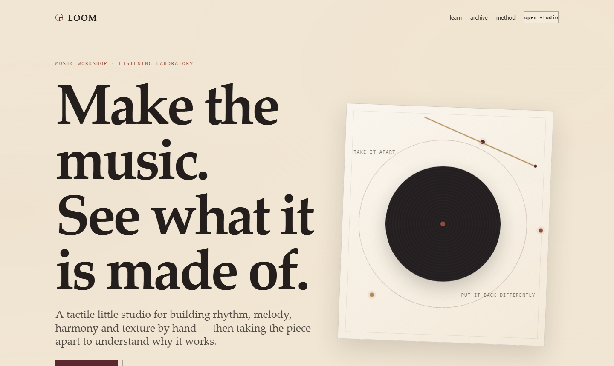

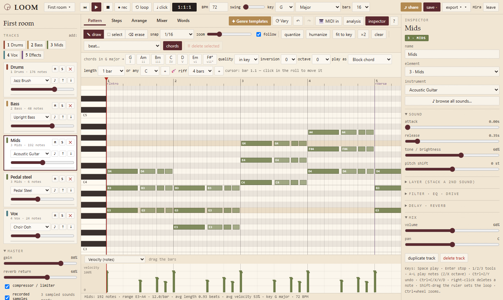

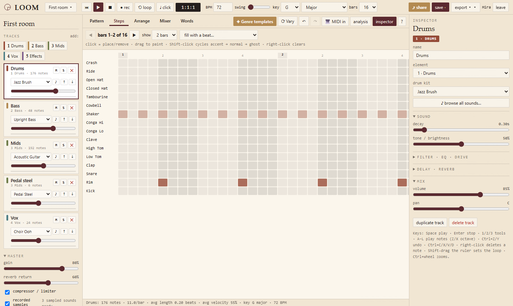

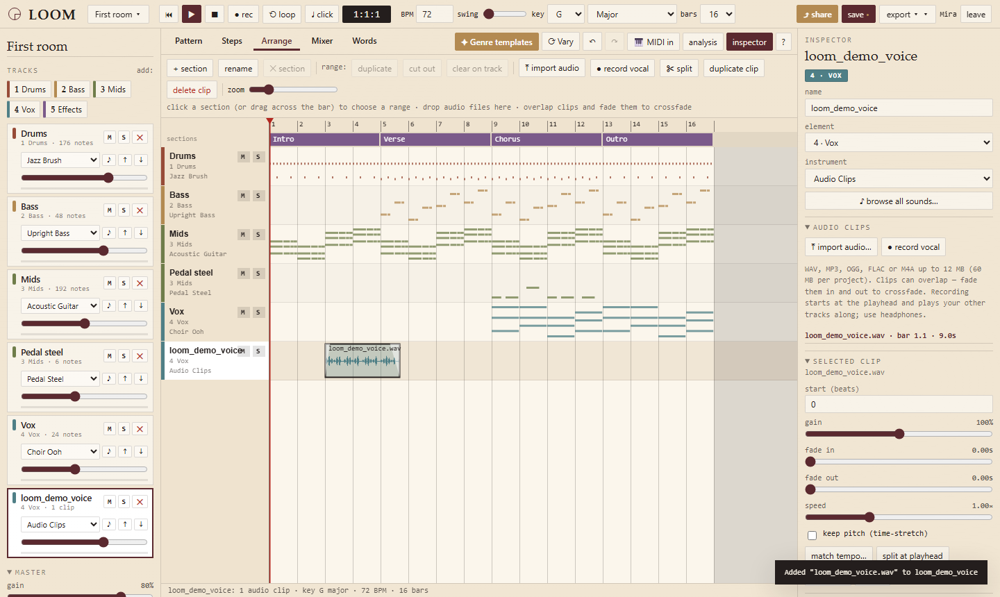

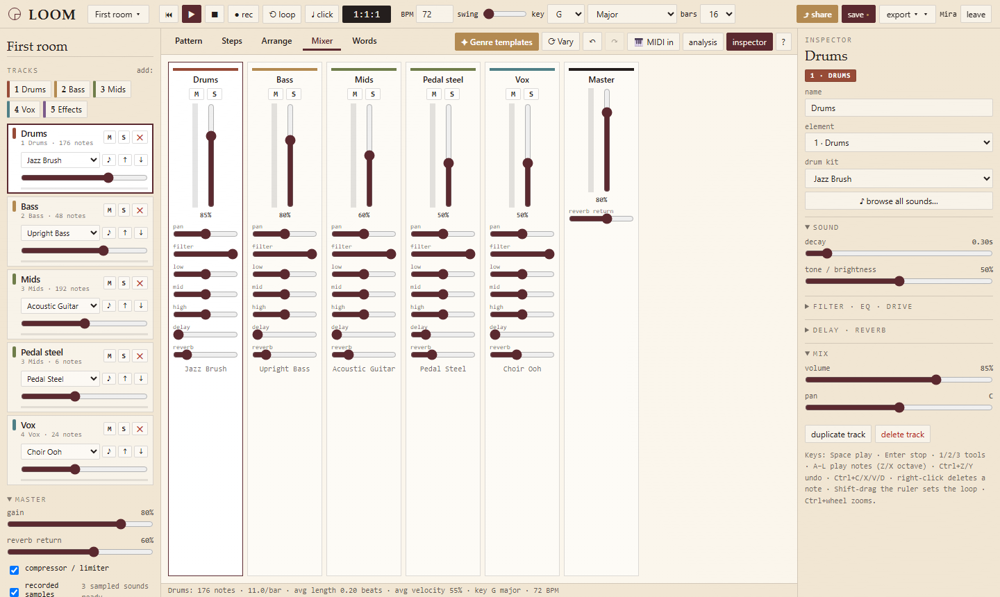

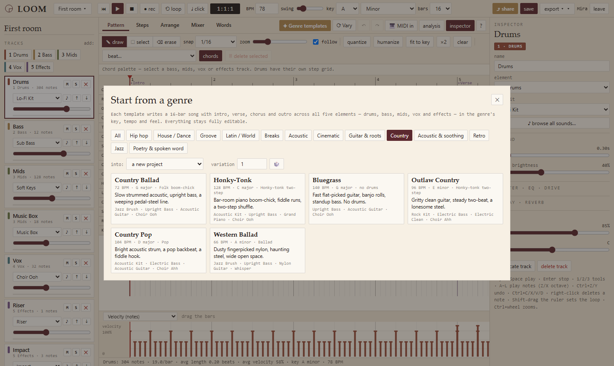

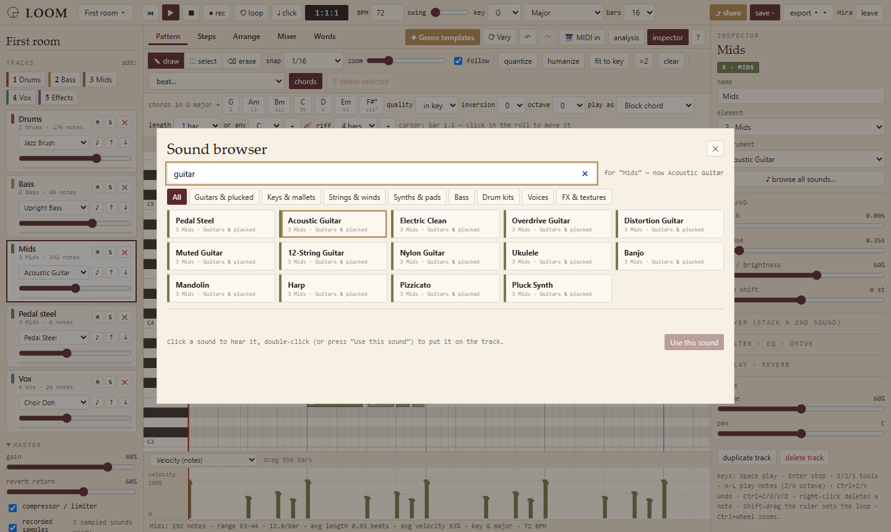

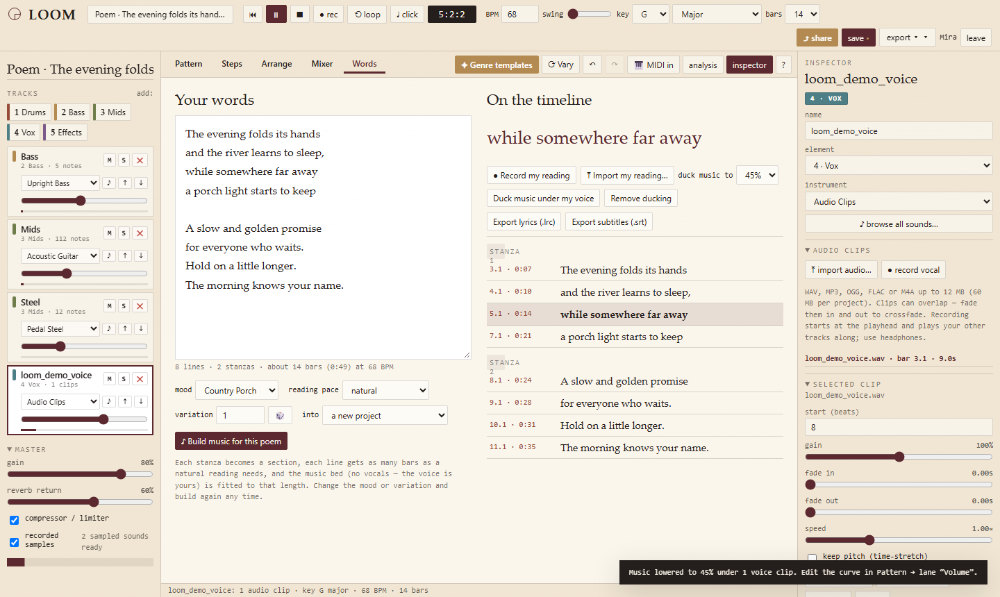

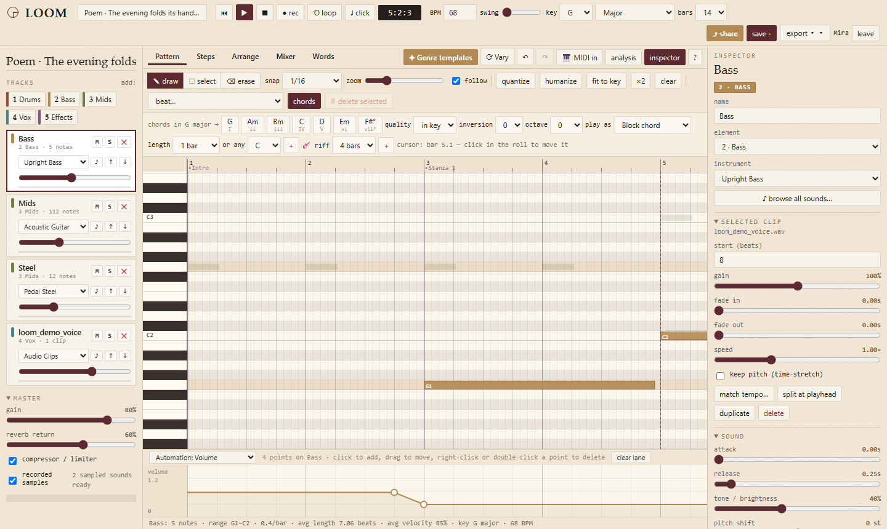

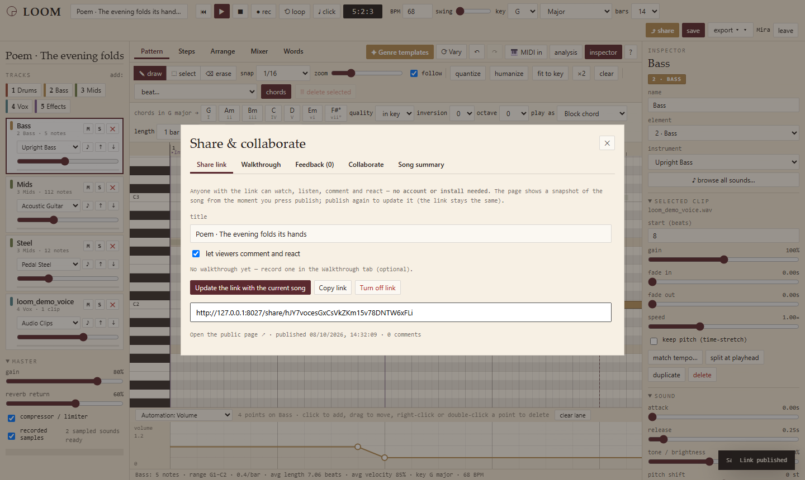

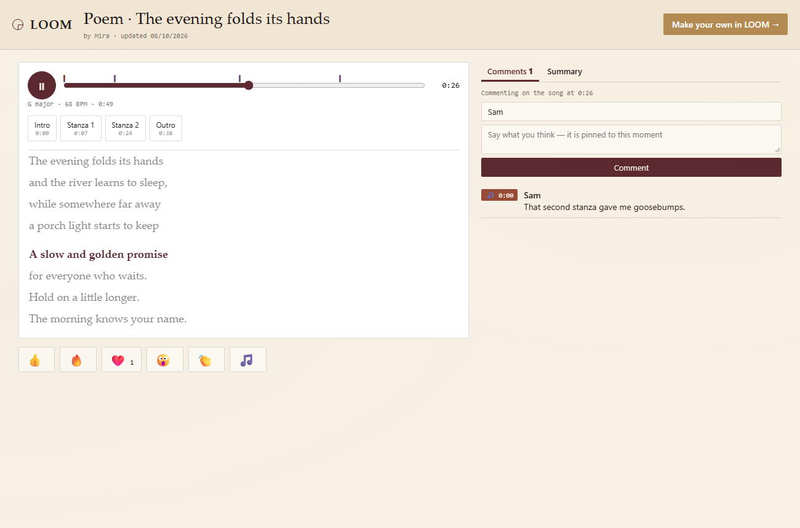

## Architecture

```text
Browser
  | Web Audio + Canvas + project editor
  v
FastAPI
  | validation / auth / analysis / persistence
  v
SQLAlchemy
  | SQLite for zero-friction local use
  | PostgreSQL for deployed use
  v
Project + revision tables

Optional boundaries:
  Elasticsearch search adapter
  Kafka/outbox event boundary
  Kubernetes / Terraform / Jenkins deployment artifacts
```

## Core data model

`users -> sessions -> projects -> project_versions` and `projects -> audio_assets` (uploaded / recorded audio, stored in the database so a project is portable between devices), with ownership enforced in every project query. Notes and audit events are separate relations. State is compact JSON because the composition is highly nested and changes as a unit; revision snapshots are bounded to the latest 40.

## Analysis

The main analysis pass uses vectorized NumPy operations for:

- per-bar note density and energy
- pitch-class profile
- velocity histogram
- note-onset novelty
- normalized pitch/time exploratory coordinates

The common feature pass is O(n) in the number of notes with a fixed-size 12-bin pitch aggregation.

## Run

```bash
python -m venv .venv
# Windows: .venv\\Scripts\\activate
source .venv/bin/activate
pip install -r requirements.txt
python -m uvicorn backend.app:app --host 127.0.0.1 --port 8000
```

Open `http://127.0.0.1:8000`.

## Production database

Copy `.env.example` to `.env`, then set `DATABASE_URL` to a PostgreSQL DSN. The same ORM model works for SQLite and PostgreSQL.

## Verify

```bash
python -m compileall -q backend
python -m pytest -q            # API, security, audio uploads, data files
node tests/gen.test.js          # chord / beat / genre / strum / riff generators, summary, diff and MIDI round-trip (no dependencies)
python scripts/verify.py --json
# browser tests (need playwright + chromium):
python scripts/smoke.py
python tests/e2e/studio_flow.py           # drives the real UI incl. audio import, sound browser, deletes, automation; renders every genre
python tests/e2e/studio_share.py          # share link, public page, walkthrough recording, comments, collaboration, conflicts, history
python tests/e2e/instrument_levels.py     # renders all 77 instruments (recorded where available), flags silence / NaN / clipping
python tools/build_samples.py             # (only if you need to rebuild assets/samples from the original sources)
```

## Data provenance

`data/source_manifest.json` records the external source boundary. `scripts/procure_mutopia.py` can refresh source metadata when outbound network access exists; it can also parse a saved HTML fixture for deterministic testing. Commercial recordings are not bundled.

## Security

See `SECURITY.md`. The important controls are Argon2id password hashing, server-side session tokens stored only as hashes, CSRF validation, rate limits, SameSite cookies, bounded request payloads and per-user ownership predicates.

## Engineering record

`PROGRESS.md` contains V1-V10 development categories. `REPORT.md` is the release report. `V10_TUTORIAL_NOTES.pdf` is the complete learning guide, from the mental model to the advanced implementation details.

## Skill-gap map

See `SKILL_GAP_COVERAGE.md`. It maps the project to the recurring technologies in the supplied job-gap dataset and explicitly calls out deliberate non-choices rather than pretending every technology is a runtime dependency.

## Source note

Mutopia's catalog provides downloadable score/MIDI entries and identifies licensing for individual editions. See the source URLs inside `data/mutopia_snapshot.json` and `data/source_manifest.json`.
